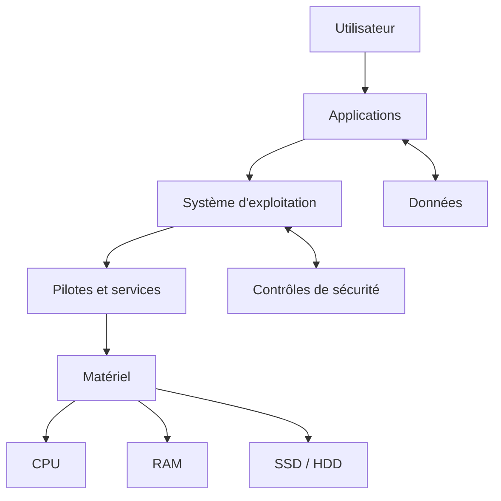
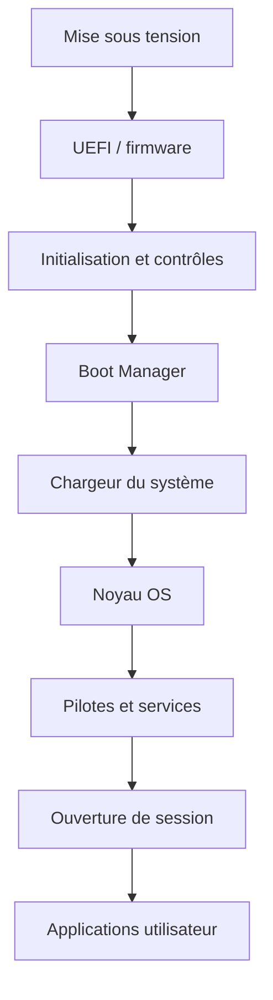
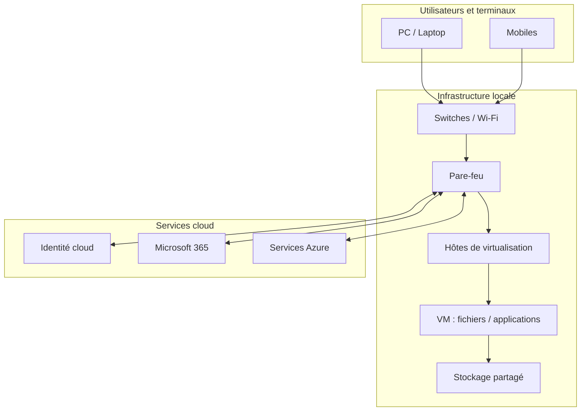

# Module 01 – Introduction à l'informatique

<small>Parcours : Microsoft IT Support Specialist · Niveau : intermédiaire à avancé · Type : théorie + laboratoire</small>

## 1. Objectifs pédagogiques

À la fin de ce module, vous serez capable de :

- décrire l'architecture fonctionnelle d'un ordinateur et le rôle de ses composants ;
- expliquer le démarrage d'un poste et les interactions entre firmware, système d'exploitation, pilotes et matériel ;
- distinguer processus, thread, service, mémoire virtuelle et stockage ;
- décrire les composants d'une infrastructure informatique d'entreprise ;
- relier les mesures de sécurité aux couches matérielles, système et applicatives ;
- conduire un inventaire technique initial et interpréter quelques indicateurs de diagnostic.

## 2. Vue d'ensemble d'un système informatique

Un système informatique associe des ressources matérielles, des logiciels, des données, des utilisateurs et des mécanismes de communication. Le support technique doit comprendre leurs dépendances : une application lente peut être causée par un manque de mémoire, un stockage saturé, un service indisponible, un pilote défectueux ou une dépendance réseau.



!!! tip "Réflexe support"
    Ne concluez pas trop vite à une panne matérielle. Définissez le symptôme, son périmètre, son heure d'apparition et les changements récents, puis vérifiez les couches une par une.

## 3. Architecture matérielle

### 3.1 Processeur (CPU)

Le CPU exécute les instructions des programmes. Il comprend des unités de calcul, des registres, des caches et des mécanismes de gestion des cœurs et des threads.

- **Cœur (core)** : unité de traitement physique capable d'exécuter des instructions.
- **Thread matériel** : contexte d'exécution logique exposé par le processeur.
- **Fréquence** : cadence d'horloge, qui ne suffit pas à elle seule à mesurer les performances.
- **Cache** : mémoire très rapide proche du CPU, organisée en niveaux (L1, L2, L3 selon l'architecture).

Un CPU fortement sollicité peut expliquer une application lente, mais il faut corréler le taux d'utilisation avec le processus concerné, la durée et les autres ressources.

### 3.2 Mémoire vive (RAM)

La RAM conserve temporairement les données et instructions utilisées par les processus. Elle est volatile : son contenu n'est normalement pas conservé après coupure de l'alimentation.

Quand la mémoire disponible devient insuffisante, le système peut déplacer certaines pages mémoire vers un stockage secondaire (fichier d'échange ou mécanisme équivalent). Cela permet de poursuivre le fonctionnement, mais un accès au stockage est beaucoup plus lent qu'un accès à la RAM.

**Indicateurs à examiner :** mémoire utilisée, mémoire disponible, engagement mémoire, pagination et processus consommateurs.

### 3.3 Stockage : HDD, SSD et NVMe

| Technologie | Principe | Points d'attention |
|---|---|---|
| HDD | Plateaux magnétiques en rotation | Temps d'accès mécanique, bruit, sensibilité aux chocs |
| SSD SATA | Mémoire flash via interface SATA | Latence réduite par rapport au HDD, débit limité par l'interface |
| SSD NVMe | Mémoire flash via protocole NVMe, généralement PCIe | Faible latence et débits élevés selon le matériel |

Le stockage conserve le système, les applications et les données après extinction. En support, vérifier l'espace libre, l'état de santé signalé par les outils du fabricant, les erreurs système et les sauvegardes avant toute opération risquée.

### 3.4 Carte mère, alimentation et périphériques

La carte mère relie les composants via des bus et interfaces. L'alimentation fournit les tensions nécessaires. Les périphériques internes ou externes communiquent par des interfaces telles que PCIe, USB, SATA, HDMI ou Bluetooth.

Un périphérique non reconnu peut être lié à une panne physique, un câble, un port, une alimentation, un pilote, une politique de sécurité ou une incompatibilité.

## 4. Démarrage et chaîne logicielle

Le démarrage d'un ordinateur moderne suit généralement ces étapes, avec des variations selon le constructeur et la configuration :

1. Mise sous tension et initialisation électrique.
2. Exécution du firmware UEFI (ou BIOS sur des systèmes plus anciens).
3. Vérifications et initialisation des composants.
4. Sélection du périphérique de démarrage.
5. Chargement du gestionnaire de démarrage.
6. Chargement du noyau du système d'exploitation.
7. Initialisation des pilotes, services et composants système.
8. Ouverture de session et lancement des éléments utilisateur.



### Firmware, pilote, noyau et service

- **Firmware** : logiciel de bas niveau stocké dans un composant matériel, chargé d'initialiser et de contrôler celui-ci.
- **Pilote** : composant logiciel permettant au système d'exploitation de communiquer avec un périphérique.
- **Noyau (kernel)** : partie centrale du système, responsable notamment de l'ordonnancement, de la mémoire et des interfaces avec le matériel.
- **Service** : programme exécuté en arrière-plan pour fournir une fonction au système ou aux applications.

## 5. Systèmes d'exploitation : processus, mémoire et matériel

### 5.1 Processus et threads

Un **processus** est une instance d'un programme en cours d'exécution, avec son espace mémoire et ses ressources. Un **thread** est un flux d'exécution au sein d'un processus. Plusieurs threads d'un même processus peuvent partager son espace mémoire.

Le système d'exploitation planifie l'exécution des threads, arbitre l'accès au CPU et isole les processus selon ses mécanismes de protection.

### 5.2 Mémoire virtuelle

Chaque processus dispose d'un espace d'adressage virtuel. Le système et le matériel de gestion mémoire traduisent les adresses virtuelles en adresses physiques, avec des mécanismes de protection et de pagination.

La mémoire virtuelle améliore l'isolation et la flexibilité ; elle ne signifie pas que le stockage secondaire est aussi rapide que la RAM.

### 5.3 Système de fichiers et permissions

Le système de fichiers organise les données en fichiers et répertoires. Les permissions déterminent les opérations autorisées (lecture, écriture, exécution ou équivalents).

Dans un environnement Windows, NTFS prend en charge des listes de contrôle d'accès (ACL). Sous Linux, les permissions classiques s'articulent autour du propriétaire, du groupe et des autres utilisateurs, avec des mécanismes complémentaires comme ACL et capabilities.

!!! warning "Principe du moindre privilège"
    Accorder uniquement les droits nécessaires à la mission. Éviter l'utilisation quotidienne d'un compte administrateur et contrôler régulièrement les appartenances aux groupes privilégiés.

## 6. Environnements informatiques d'entreprise

Une entreprise combine généralement plusieurs briques :

- **Postes clients** : ordinateurs portables, stations fixes, mobiles et périphériques.
- **Serveurs** : services d'identité, fichiers, applications, bases de données, impression ou supervision.
- **Stockage** : DAS, NAS, SAN ou stockage objet selon les besoins.
- **Réseau** : commutateurs, routeurs, Wi-Fi, pare-feu, VPN et liens opérateurs.
- **Virtualisation** : exécution de plusieurs machines virtuelles sur un hôte physique.
- **Cloud** : ressources consommées à la demande auprès d'un fournisseur, avec responsabilités partagées.
- **Outils de gestion** : inventaire, supervision, déploiement, gestion des terminaux et ITSM.



### 6.1 Serveurs et rôles

Un serveur est un système qui fournit des ressources ou services à d'autres systèmes. Il peut être physique ou virtuel. Exemples de rôles :

- serveur d'identité et d'annuaire ;
- serveur de fichiers et d'impression ;
- serveur applicatif ;
- serveur de base de données ;
- serveur de sauvegarde ;
- serveur de supervision.

Il faut documenter le rôle, les dépendances, la criticité, les propriétaires techniques, les sauvegardes, la supervision et les procédures de reprise.

### 6.2 Stockage d'entreprise

- **DAS** : stockage directement attaché à un serveur.
- **NAS** : stockage accessible via le réseau, souvent au niveau fichier.
- **SAN** : réseau dédié ou spécialisé fournissant du stockage en mode bloc.
- **Stockage objet** : données stockées sous forme d'objets avec métadonnées et identifiants, courant dans le cloud.

Le choix dépend des performances, de la disponibilité, de la capacité, du coût, des protocoles et des exigences de reprise.

### 6.3 Virtualisation

La virtualisation permet de partager les ressources physiques d'un hôte entre plusieurs machines virtuelles. Un hyperviseur gère l'allocation du CPU, de la mémoire, du réseau et du stockage.

Avantages : consolidation, isolation logique, provisionnement plus rapide et flexibilité. Points de vigilance : capacité de l'hôte, dépendance au stockage partagé, sauvegarde cohérente, segmentation réseau, mises à jour et sécurité de l'hyperviseur.

## 7. Sécurité : matériel, système et logiciel

La sécurité doit être pensée en couches :

| Couche | Exemples de contrôles |
|---|---|
| Physique | Contrôle d'accès aux locaux, verrouillage, protection contre le vol |
| Firmware / démarrage | UEFI sécurisé, Secure Boot, mot de passe firmware selon politique |
| Stockage | Chiffrement de disque, protection des clés, effacement sécurisé |
| Système | Correctifs, pare-feu local, antivirus/EDR, durcissement |
| Identité | MFA, comptes séparés, moindre privilège, révocation des accès |
| Application | Mises à jour, configuration sûre, contrôle des permissions |
| Données | Classification, chiffrement, sauvegardes, contrôle d'accès |
| Exploitation | Journalisation, supervision, gestion des vulnérabilités et incidents |

### Exemple : protection d'un poste Windows

- Activer et superviser le chiffrement de disque selon la politique de l'organisation.
- Maintenir Windows, les pilotes et les applications à jour.
- Utiliser une protection endpoint gérée et surveillée.
- Appliquer le principe du moindre privilège.
- Exiger l'authentification multifacteur pour les accès compatibles.
- Verrouiller automatiquement la session.
- Sauvegarder les données professionnelles vers un emplacement approuvé.
- Vérifier que les journaux et alertes sont remontés vers les équipes responsables.

!!! danger "Attention aux données sensibles"
    Ne jamais exporter, publier ou joindre à ce portfolio des clés de récupération BitLocker, mots de passe, jetons, secrets d'API, journaux contenant des données personnelles ou captures d'écran internes.

## 8. Laboratoire pratique – Inventaire et diagnostic d'un poste Windows

### Objectif

Réaliser un inventaire non intrusif d'un poste de laboratoire, identifier ses caractéristiques principales et collecter quelques indicateurs utiles au support.

### Prérequis

- Un poste Windows 10/11 de test ou une machine virtuelle.
- Un compte utilisateur standard suffit pour la majorité des commandes.
- PowerShell.
- Aucun changement de configuration n'est requis.

### Étape 1 – Identifier le système

```powershell
Get-ComputerInfo |
  Select-Object CsName, WindowsProductName, WindowsVersion,
                OsArchitecture, CsManufacturer, CsModel
```

**À observer :** nom du poste, édition/version Windows, architecture et constructeur/modèle lorsque ces informations sont exposées.

### Étape 2 – Examiner le processeur et la mémoire

```powershell
Get-CimInstance Win32_Processor |
  Select-Object Name, NumberOfCores, NumberOfLogicalProcessors

Get-CimInstance Win32_OperatingSystem |
  Select-Object TotalVisibleMemorySize, FreePhysicalMemory
```

Les valeurs mémoire CIM sont exprimées en kilo-octets. Pour une conversion approximative en Gio, diviser par 1 048 576.

### Étape 3 – Examiner les volumes

```powershell
Get-Volume |
  Select-Object DriveLetter, FileSystemLabel, FileSystem,
    @{Name='SizeGB';Expression={[math]::Round($_.Size / 1GB, 2)}},
    @{Name='FreeGB';Expression={[math]::Round($_.SizeRemaining / 1GB, 2)}}
```

Ne pas conclure qu'un disque est défectueux sur la seule base de l'espace libre. Corréler avec les alertes système et les outils de santé du constructeur.

### Étape 4 – Examiner les processus les plus consommateurs

```powershell
Get-Process |
  Sort-Object CPU -Descending |
  Select-Object -First 10 Name, Id, CPU,
    @{Name='WorkingSetMB';Expression={[math]::Round($_.WorkingSet64 / 1MB, 1)}}
```

La propriété CPU de Get-Process représente le temps CPU cumulé du processus, pas un pourcentage instantané d'utilisation.

### Étape 5 – Produire un rapport local

```powershell
$report = [pscustomobject]@{
    ComputerName = $env:COMPUTERNAME
    CollectedAt  = Get-Date
    OS           = (Get-CimInstance Win32_OperatingSystem).Caption
    Architecture = (Get-CimInstance Win32_OperatingSystem).OSArchitecture
    CPU          = (Get-CimInstance Win32_Processor | Select-Object -First 1 -ExpandProperty Name)
    RAM_GB       = [math]::Round(
        (Get-CimInstance Win32_ComputerSystem).TotalPhysicalMemory / 1GB, 2
    )
}

$report | Format-List
```

Pour un partage ou une collecte centralisée, utiliser uniquement un emplacement autorisé et respecter les règles de confidentialité de l'organisation.

### Fiche de restitution du laboratoire

| Élément | Résultat à renseigner |
|---|---|
| Système et version | À compléter |
| Architecture | À compléter |
| CPU / cœurs / threads | À compléter |
| RAM installée | À compléter |
| Volumes et espace libre | À compléter |
| Processus à examiner | À compléter |
| Anomalies observées | À compléter |
| Recommandations | À compléter |

## 9. Étude de cas – Poste utilisateur lent

### Situation

Un utilisateur signale que son poste est devenu lent depuis le début de la matinée. Le problème concerne principalement l'ouverture de plusieurs applications.

### Démarche d'investigation

1. **Qualifier** : depuis quand, quelles applications, un seul utilisateur ou plusieurs, incident permanent ou intermittent ?
2. **Vérifier les ressources** : CPU, mémoire, disque et processus dans le Gestionnaire des tâches.
3. **Contrôler le stockage** : espace disponible et éventuelles alertes.
4. **Examiner les événements** : erreurs système et applicatives à l'heure du problème.
5. **Vérifier les changements** : mise à jour, installation, nouveau périphérique ou modification récente.
6. **Tester une hypothèse à la fois** : ne pas désactiver globalement les protections de sécurité.
7. **Valider avec l'utilisateur** : reproduire le scénario et confirmer le retour à la normale.
8. **Documenter** : cause confirmée ou non, actions, résultats et prévention.

### Exemple de compte rendu d'incident

```text
Titre : Ralentissement d'un poste utilisateur
Impact : Un utilisateur – applications bureautiques
Début : [date/heure à renseigner]
Constat : [mesures observées]
Hypothèses : CPU / mémoire / stockage / application / réseau
Vérifications : [commandes et observations]
Action : [action autorisée et réalisée]
Résultat : [résultat mesuré]
Statut : Résolu / Contournement / Escalade
Prévention : [recommandation]
```

Ce scénario est un exercice pédagogique : ne le présenter comme une intervention réellement réalisée que si les faits correspondent à une expérience vérifiable.

## 10. Bonnes pratiques de documentation technique

Une documentation exploitable doit préciser :

- le périmètre et les prérequis ;
- la version des systèmes concernés ;
- les droits nécessaires ;
- les étapes reproductibles ;
- les résultats attendus ;
- les risques et mesures de retour arrière ;
- les preuves non sensibles ;
- la date de dernière vérification.

## 11. Quiz de validation

Répondez avant d'ouvrir les explications.

??? question "1. Quel est le rôle principal de la RAM ?"
    **Réponse :** conserver temporairement les données et instructions utilisées par les programmes en cours d'exécution. Elle est volatile.

??? question "2. Quelle différence fondamentale existe entre un processus et un thread ?"
    **Réponse :** un processus est une instance de programme disposant de ressources et d'un espace d'adressage ; un thread est un flux d'exécution au sein d'un processus.

??? question "3. Pourquoi la mémoire virtuelle ne remplace-t-elle pas la RAM ?"
    **Réponse :** elle fournit un espace d'adressage et peut s'appuyer sur la pagination vers le stockage, mais les accès au stockage sont beaucoup plus lents que ceux à la mémoire vive.

??? question "4. Quel composant initialise le matériel avant le chargement du système d'exploitation ?"
    **Réponse :** le firmware de la plateforme, généralement UEFI sur les ordinateurs récents.

??? question "5. Quelle différence entre NAS et SAN ?"
    **Réponse :** un NAS fournit généralement un accès au niveau fichier ; un SAN fournit généralement un accès au stockage en mode bloc.

??? question "6. Pourquoi la propriété CPU de Get-Process ne donne-t-elle pas directement un pourcentage instantané ?"
    **Réponse :** elle représente le temps CPU cumulé consommé par le processus depuis son démarrage.

??? question "7. Citez trois contrôles de sécurité complémentaires pour un poste professionnel."
    **Réponse :** par exemple chiffrement du disque, mises à jour, EDR, MFA, moindre privilège, verrouillage de session et sauvegarde approuvée.

??? question "8. Un poste est lent : quelle est la première démarche pertinente ?"
    **Réponse :** qualifier le symptôme, le périmètre et le contexte avant de mesurer les ressources et de tester des hypothèses.

## 12. Checklist de maîtrise

- [ ] Je sais expliquer CPU, RAM, stockage et périphériques.
- [ ] Je sais décrire la séquence de démarrage UEFI.
- [ ] Je distingue noyau, pilote, service, processus et thread.
- [ ] Je comprends le principe de mémoire virtuelle.
- [ ] Je sais différencier serveur physique, machine virtuelle et service cloud.
- [ ] Je peux décrire DAS, NAS, SAN et stockage objet.
- [ ] Je sais collecter un inventaire Windows avec PowerShell.
- [ ] Je sais structurer un diagnostic sans modifier inutilement le poste.
- [ ] Je sais documenter un incident sans exposer de données sensibles.

## 13. Références officielles

- [Microsoft Learn – Windows client documentation](https://learn.microsoft.com/windows/)
- [Microsoft Learn – PowerShell documentation](https://learn.microsoft.com/powershell/)
- [Microsoft Learn – Windows security](https://learn.microsoft.com/windows/security/)
- [UEFI Forum – Specifications](https://uefi.org/specifications)
- [NIST – Computer Security Resource Center](https://csrc.nist.gov/)

---

**Fin du module 01.** Le prochain module approfondira les réseaux sécurisés : modèles OSI et TCP/IP, adressage IP, équipements, protocoles et segmentation.
